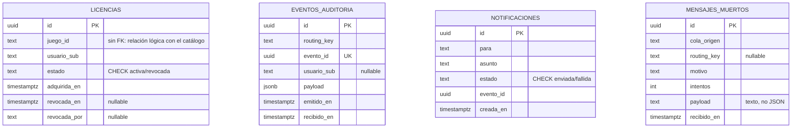

# Modelo de datos

Una sola instancia de Postgres (puerto 5433), dos esquemas, un dueño por esquema. Ninguna consulta cruza la
frontera: lo que un consumidor necesita de una licencia viaja en el payload del evento.

Las tablas las crea TypeORM con `synchronize: true`, solo en desarrollo. `postgres/init.sql` solo crea los
esquemas `licencias` y `eventos`. En producción `synchronize` no se usa: compara el esquema con las entidades
y una columna renombrada puede terminar borrada con sus datos; se usan migraciones.

## Frontera entre dueños

| Esquema | Tabla | Dueño |
|---|---|---|
| `licencias` | `licencias` | licencias-service (escribe y sirve `GET /v1/biblioteca`) |
| `eventos` | `eventos_auditoria`, `notificaciones`, `mensajes_muertos` | vidalstore-eventos |

Relación lógica (no es FK): `licencias.juego_id` apunta al catálogo, que lo sirve otro servicio desde
`data/juegos.json`. Una FK convertiría dos servicios en uno con dos procesos. `notificaciones.evento_id` y
`eventos_auditoria.evento_id` se relacionan solo por valor, dentro del mismo dueño.

## Restricciones

| Tabla | Restricción | Para qué |
|---|---|---|
| licencias | PK uuid | identidad de la fila |
| licencias | `uq_licencia_activa`: UNIQUE (usuario_sub, juego_id) WHERE estado = 'activa' | un jugador no tiene dos licencias vigentes del mismo juego, pero puede recomprarlo tras una revocación. Vive en la base, no en un `if` del controlador |
| licencias | `chk_licencia_estado`: estado IN ('activa','revocada') | un enum de TypeScript no impide que otro proceso escriba cualquier texto |
| eventos_auditoria | `uq_auditoria_evento_id`: UNIQUE (evento_id) | idempotencia: RabbitMQ reentrega (at least once); la segunda inserción falla por conflicto, el consumidor hace ack y no se duplica. Probado: el mismo x-evento-id publicado dos veces dejó 1 fila |
| eventos_auditoria | `payload` jsonb NOT NULL | el payload de un evento siempre es JSON válido y se puede consultar por campo |
| notificaciones | `chk_notificacion_estado`: estado IN ('enviada','fallida') | igual que arriba |
| notificaciones | sin UNIQUE sobre `evento_id` | Decisión: el enunciado exige el UNIQUE solo en auditoría. Consecuencia, probada: el mismo evento publicado dos veces generó 2 avisos. El enunciado reconoce que la idempotencia de auditoría no cubre avisos ni correos |
| mensajes_muertos | `routing_key` nullable, `payload` text | un mensaje puede morir por no ser JSON o sin routing key; se guarda tal cual llegó (probado con `scripts/envenenado.mjs json-roto`) |

## Índices

| Índice | Consulta que lo justifica |
|---|---|
| `idx_licencias_usuario` (usuario_sub) | `GET /biblioteca` filtra por usuario |
| `uq_licencia_activa` | además de la regla, acelera la comprobación al comprar |
| `idx_auditoria_routing_recibido` (routing_key, recibido_en) | buscar qué pasó de un tipo de evento en un rango de fechas |
| mensajes_muertos: solo la PK | no hay consulta frecuente por otra columna; un índice más solo haría más lenta la escritura |
| notificaciones: solo la PK | ídem |

## Tipos

`timestamptz` para todo instante, `jsonb` para el payload de un evento y `text` para el de un mensaje muerto.
